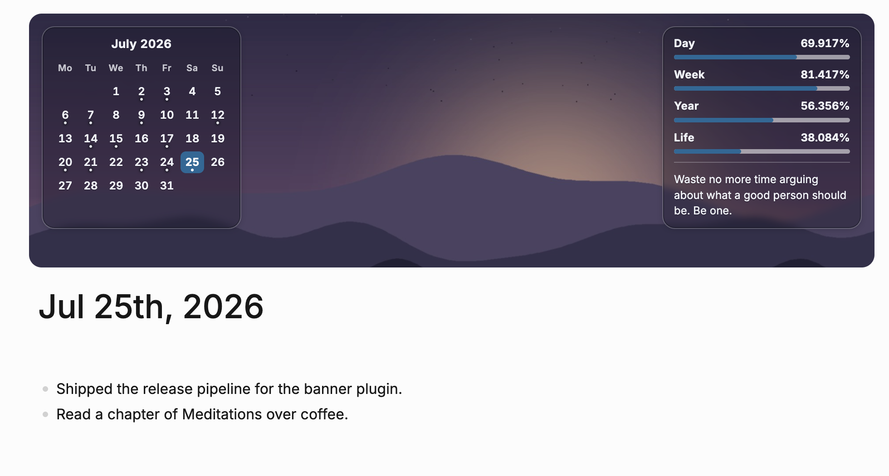

  
  <h1>DB Banner</h1>
  
<b>A calmer view of your time, at the top of every journal.</b>

  
English · <a href="README_CN.md">中文</a>

  
  
  
  

 

  

## Features

| Feature | When | What it does |
| :--- | :--- | :--- |
| Month calendar | In a journal | Highlights today, marks days with journal content, browses months, and opens any displayed date when clicked. |
| Time progress | Every second | Shows progress through the day, week, year, and (if configured) life. |
| Wallpaper | In a journal | Adds a local or graph wallpaper behind the widgets; uses a gradient when unset or unavailable. |
| Quote | In a journal | Picks a quote from tagged blocks or pages when you arrive at a journal view. |

## Install

In Logseq, open **Plugins → Marketplace**, search for **DB Banner**, and install it. The plugin supports DB graphs only.

## Usage / Settings

The banner appears on journal feeds and journal pages. Pin **DB Banner** from the toolbar's plugins popover, then click its toolbar icon to open settings. Changes apply immediately.

| Setting | Default | Notes |
| :--- | :--- | :--- |
| `wallpaperSource` | Empty | Absolute local path, `https://` URL, `data:` URI, or path relative to the graph's `assets` folder. |
| `wallpaperFit` | `cover` | `cover`, `contain`, or `tile`. |
| `wallpaperPosition` | `50% 50%` | CSS background position. |
| `bannerHeight` | `280px` | Minimum height; grows if widgets need more room. |
| `birthDate` | Empty | `YYYY-MM-DD`; required for life progress. |
| `lifespanYears` | `85` | Life-progress denominator. |
| `weekStart` | `monday` | `monday`, `sunday`, or `saturday`; also sets the calendar's first day. |
| `quoteTag` | `quotes` | Tag on quote blocks or pages; use `Quote` for Logseq's built-in Quote type. Empty disables the quote. |
| `showCalendarWidget`, `showDayWidget`, `showWeekWidget`, `showYearWidget`, `showLifeWidget`, `showQuoteWidget` | `true` | Toggle each widget. |

## Why

A journal page holds more than today's notes: it gives you a place to orient yourself in the day and see time in a wider frame. But that context is usually scattered across the graph or absent from the page.

DB Banner puts a small calendar and time-progress widgets over a wallpaper, without changing ordinary pages. It stays focused on Logseq DB graphs and keeps the useful context close to the journal.

## Uninstall

In Logseq, open **Plugins → Installed**, find **DB Banner**, and choose **Uninstall**.

## Contributing

See [AGENTS.md](AGENTS.md) for repository notes and [CHANGELOG.md](CHANGELOG.md) for release history. Issues and pull requests are welcome.

## License

[MIT](LICENSE)
