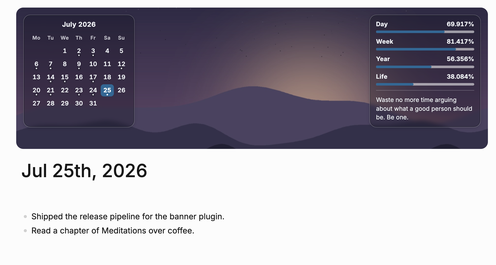

  
  <h1>DB Banner</h1>
  
<b>在每篇日记顶部，轻松看见时间的流动。</b>

  
<a href="README.md">English</a> · 中文

  
  
  
  

 

  

## 功能

| 功能 | 适用场景 | 作用 |
| :--- | :--- | :--- |
| 月历 | 日记视图 | 标出今天和已有内容的日期，可切换月份，点击当前显示的日期即可打开对应日记。 |
| 时间进度 | 每秒更新 | 显示当天、本周、本年和（配置后）人生进度。 |
| 壁纸 | 日记视图 | 在组件后显示本地或图谱壁纸；未设置或无法读取时使用渐变背景。 |
| 每日语录 | 日记视图 | 进入日记视图时，从已标记的块或页面中选取一条语录。 |

## 安装

在 Logseq 中打开 **Plugins → Marketplace**，搜索 **DB Banner** 并安装。插件仅支持 DB 图谱。

## 使用 / 设置

横幅显示在日记列表和单篇日记页面。可在工具栏的插件菜单中固定 **DB Banner**，再点击工具栏图标打开设置。修改会立即生效。

| 设置 | 默认值 | 说明 |
| :--- | :--- | :--- |
| `wallpaperSource` | 空 | 本地绝对路径、`https://` 链接、`data:` URI，或相对于图谱 `assets` 目录的路径。 |
| `wallpaperFit` | `cover` | 可选 `cover`、`contain`、`tile`。 |
| `wallpaperPosition` | `50% 50%` | CSS 背景位置。 |
| `bannerHeight` | `280px` | 最小高度；组件需要更多空间时会自动增高。 |
| `birthDate` | 空 | 格式 `YYYY-MM-DD`；人生进度需要此项。 |
| `lifespanYears` | `85` | 人生进度的计算年限。 |
| `weekStart` | `monday` | 可选 `monday`、`sunday`、`saturday`，也决定月历首列。 |
| `quoteTag` | `quotes` | 语录块或页面上的标签；填 `Quote` 可使用 Logseq 内置 Quote 类型。留空则关闭语录。 |
| `showCalendarWidget`、`showDayWidget`、`showWeekWidget`、`showYearWidget`、`showLifeWidget`、`showQuoteWidget` | `true` | 分别控制组件显示。 |

## 为什么

日记不只是当天的记录，也适合帮助你了解当下，并把时间放在更长的尺度里观察。但这些信息通常散落在图谱各处，或没有出现在日记页上。

DB Banner 将月历和时间进度组件放在壁纸之上，不改变普通页面。它专注于 Logseq DB 图谱，让日记页保留这些有用的上下文。

## 卸载

在 Logseq 中打开 **Plugins → Installed**，找到 **DB Banner** 并选择 **Uninstall**。

## 参与贡献

仓库说明见 [AGENTS.md](AGENTS.md)，版本记录见 [CHANGELOG.md](CHANGELOG.md)。欢迎提交 Issue 和 Pull Request。

## 许可证

[MIT](LICENSE)
